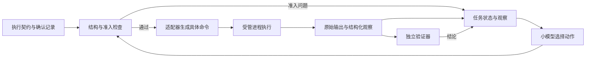

# 环境准备

环境准备让用户指定版本的框架在约定资源上完成真实请求。准备路径由输入和反馈决定，可涉及 Python 环境、原生构建或预编译程序。开发状态见[环境准备计划](../plan/environment.md)。

## 工作流程

`固定输入 → 收集证据 → 形成准备方案 → 隔离执行 → 验证真实请求`

执行失败后，日常模型根据结果修订假设和下一步。每次尝试保留版本、动作、反馈与成本；只有具备新信息或新假设才重复试验。

输入包含框架来源、模型产物、设备要求和行为契约。模型说明用于分析指定框架的兼容性，框架选择始终来自用户任务。

## 证据与决策

| 能力 | 用途 |
|---|---|
| `list`、`read` | 发现文件、读取有行号的原文 |
| `search`、`outline` | 在单文件中定位字面匹配或 Markdown 章节 |
| `declarations`、`machine` | 提取依赖声明、观察机器与工具条件 |
| `catalog`、`recall`、`pin` | 查阅历史证据、保留所选窗口 |

文件工具显式指定 `framework` 或 `model` 根。原始结果和哈希留存，决策上下文分别呈现固定身份、机器事实、文件清单、正文和建议。

搜索无匹配仅说明字面串未出现；PATH 未找到工具仅说明当前进程无法定位它。两者都不直接形成兼容性结论。

## 方案与修正

模型提交准备步骤、验证方法、文件选择、限制和未知项。引用使用当前展示的连续原文行，覆盖框架和模型两侧；程序装配固定 commit、来源和引文。目录与机器事实用于补充条件。

`repair_finish` 根据草案 ID 替换指定字段，再完整校验候选。完整草案、字段补丁和装配报告分别留存；草案引用的有效源行优先重现，避免为修一个字段重写整份方案。

| 保护范围 | 协议上限 |
|---|---|
| 决策视图 | 24000 UTF-8 字节 |
| 单项行引用 | 1–8 连续行，5–2000 字符 |
| 保留窗口 | 最多 6 个，合计 4500 字节 |
| 完整草案 / 展示摘要 | 48000 / 4500 字节 |
| 一次字段修正 | 1–12 个显式替换 |

## 执行契约

调查输出是建议；执行契约是供工具消费的显式任务快照。E1 校验声明与文件元数据，E2 验证固定伪进程链，E3 接入真实适配器、执行授权和环境复核。原只读调查入口保持不变。

| 内容 | 契约要求 | 所属对象 |
|---|---|---|
| 框架身份 | 用户来源、已固定的完整 commit、准备记录 | `Task.target` 与 Run 的框架绑定 |
| 模型选择 | 恰好选定一个文件集合；集合内声明权重、分片、配套文件及内容身份，备选集合单列 | `Task.model` |
| 资源与权限 | 设备身份、允许的工具/网络/写入范围、每步和整段预算 | `Task.resources/budget/contract` |
| 构建 | 适配器版本、构建配置或允许的参数范围、依赖身份 | `Task.contract` |
| 请求 | 固定输入样本、推理参数、接口及输出解析方式 | `Task.workload` |
| 验收 | 必须通过的检查、参考来源、容差和验证器版本 | `Task.contract` |

模型可以提议文件集合，但执行前必须明确选择，不能根据文件顺序、后缀或“只找到一个文件”自动决定。Q4 与 Q8 是不同备选；分片属于同一集合。变更选择或验收标准生成新契约，既有调查和结果保留。

确认记录绑定契约版本及内容哈希。执行前核对源文件、工具路径和实际设备；仅有文件名或历史机器观察不足以准入。旧报告的 `model_files` 若含义不清，进入待确认状态，不自动转为加载列表。

### 完整诊断

先校验结构，再检查相互独立的字段与约束，一次返回所有可判断的问题。每项包含字段位置、错误码、原因和修正要求；依赖缺失前置条件的检查标为跳过并说明依赖。

前置条件按动作检查：缺少模型选择不阻止已授权的只读 `probe`，`build` 和 `run_once` 分别检查所需依赖。必需的准入检查全部通过且授权匹配，才产生可执行动作。准入不证明运行兼容性；实际请求和设备使用留给运行验证。

### E1 离线接口

`validate_execution(task, action, approval)` 接受现有 `Task` 或未补默认值的 JSON 对象。`contract.execution.version` 为 `1`，顶层身份与预算沿用 Task 字段。

| 字段 | 声明内容 |
|---|---|
| `model` | `kind=local`、绝对 `path`、单个 `selected_set`、`sets` 列表 |
| `sets[]` | `id`、`layout=single\|sharded`、有序 `weights`、`support`；文件项为 `path/sha256/bytes` |
| `contract.execution.framework` | 完整 `commit`、`prepare_run/prepare_call/prepare_output_hash` |
| `contract.execution.adapter` | `name/version/build_parameters` |
| `contract.execution.permissions` | `network=none`、`write_scopes`（build/scratch）、`tools`、`trusted_code` |
| `contract.execution.limits` | `step_seconds/cpu_threads/memory_mib/gpu_memory_mib/disk_mib/output_mib` |
| `workload.request` | `interface=cli`、固定 `input`、`parameters` |
| `contract.execution.acceptance` | `scope=smoke\|behavior`、版本化 `parser/verifier`、`reference`、`tolerances` |
| `approval`（独立输入） | `task_hash/approved_by/actions`，按整个 Task 内容绑定并限定动作种类 |

`probe` 动作指定 `targets`（host/toolchain/gpu），`build` 只指定种类，`run_once` 另提供 `build_call`。探测不要求模型、请求或准备结果；构建不要求模型与请求。行为验收需参考文件及数值容差，冒烟的参考和容差为 null。完整输入示例见 `tests/test_execution_contract.py` 的 `fixture()`。

结果包含 `checks`、`diagnostics` 和 `pending_action`。只有离线检查通过才返回 `requires_runtime_checks` 待执行数据；始终标记 `executed=false`、`execution_authorized=false`。未知动作会跳过语义相关检查；已知动作缺参数不掩盖独立的权限或设备错误。

E1 只以 `O_PATH/fstat` 检查选定文件及行为参考的元数据，不读权重。真实执行前必须复核内容哈希、分片语义、prepare/build 记录、适配器能力、GPU 状态和授权；当前 E2 仅验证固定夹具路径，不承担真实输入的这些检查。声明为分片不能证明多个量化文件确是同一模型分片。

## 最小执行器

首版处理可信原生项目的构建和单次命令行推理，复用 Run、Call、预算与进程监管。不先接常驻服务、通用包安装或任意 shell。

| 动作 | 输入 | 返回 |
|---|---|---|
| `probe` | 需确认的工具或设备 | 路径、版本、可用性及未确认项 |
| `build` | 固定源码、构建配置、依赖和输出目录 | 构建产物身份、实际环境、退出与日志记录 |
| `run_once` | 构建产物、选定模型集合、固定请求与参数 | 本次原始响应、设备证据、退出与清理结果 |

动作名不直接作为 CLI 新命令。小模型选择已注册动作及参数，适配器负责生成显式 `argv/cwd/env`，校验实际命令后执行；说明文字和日志不作为命令来源。缺少依赖时返回阻塞，安装需要另行确定范围。

### E2 固定夹具接口

`FixtureExecutor` 只运行仓库自带的 `fixture_worker.py`。输入和伪权重由测试驱动生成；伪构建产生带 Task 哈希的 JSON，伪推理完成固定文本变换。验证器独立比较结果，全部产物标记 `synthetic`；它不是通用原生项目执行器。

执行器复用 `Calls.new/finish`，每次进程保存具体命令、环境、原始日志、退出状态和验证结论。推理只引用同一 Run 内、绑定同一契约且验证通过的构建 Call；启动前与接受结果前均复核夹具和产物。E1 报告在每次调用中留存，测试授权仅适用于固定夹具。

- stdout/stderr 同时分块读取，落盘合计不超过契约 `output_mib`；磁盘按 Run 累计检查，收尾后再次核对。
- supervisor 管理 worker 生命周期；固定后代另绑定 worker 死亡信号。取消、超时、快速退出和父进程死亡均有独立测试。
- 清理异常按 `cleanup_failed` 锁止后续启动；Run 只允许一次执行器认领，不能重建实例重置预算。强杀留下的 Run 标记为 interrupted，不伪造终态或重放。

真实目标的授权认证、注册适配器、设备验证及恢复在 E3 接入前完成；夹具中的伪 prepare 标识不作为真实 Git commit 证明。

### llama.cpp 命令规划接口

`plan_completion(task, locations)` 是纯函数，只规划已核对的上游 commit `0fb8f1577027`。该版本的 `llama-cli` 内含 HTTP server；这里选择同框架的 `llama-completion`，保留无服务的单次请求范围。

- Task 选用 `llama-completion` v1 适配器，构建参数显式指定数字 `cuda_arch`；请求给出 `seed/max_tokens/ctx_size/gpu_layers/temperature`。初版只支持一个自包含 GGUF、一个 GPU UUID 和温度 0 的冒烟契约。
- `locations` 提供绝对的 `run_root/source/build/scratch/cmake/make/cc/cxx/nvcc` 路径。输出三条 `argv/cwd/env` 草案，环境不继承，固定构建目标，关闭 UI 下载、自动 fit、warmup 和交互模式。
- 输出为 `draft`，附 Task/plan 哈希和必需运行检查。不读取这些路径、不确认权限、不执行命令；E1 校验及真实执行前复核仍不可省略。输入示例见 `tests/test_llama_completion.py`。
- `parse_completion_log(text, complete=...)` 按该版本 stderr 格式提取原行证据。设备枚举不等于使用设备，prompt token 不等于生成 token；`eval_runs` 单列。缺失、重复或截断日志返回 `inconclusive`，完整信号仅记 `evidence_present`。

源码依据：`tools/CMakeLists.txt`、`tools/completion/CMakeLists.txt`、`common/arg.cpp`、`src/llama.cpp`、`src/llama-model.cpp`、`src/llama-context.cpp`。日志证据需与真实 Call、正常退出及设备映射关联后才能用于冒烟判定。

### 准备与构建记录核验

`check_completion_records(data_root, task, locations, build_call=None)` 只读核对记录来源。它重新生成命令计划，将 Run、真实 `framework.prepare` 和契约绑定；提供 build Call 时，继续检查 configure/build 的输入输出哈希、实际命令、正常退出、清理和验证结果，再有界读取二进制核对内容身份。

构建记录采用 `completion.configure/build`、`completion-executor-v1`：输入包含 `task_hash/plan_hash/command`，build 另绑定 `configure_call/configure_output_hash`；输出包含 `process/verification`，build 另带 `artifact.path/bytes/sha256`。该记录协议供后续真实执行器写入，不能用 fixture Call 替代。

prepare/configure/build 必须属于当前 Run；旧检查点应先导入新 Run，不跨运行直接借用二进制。读取逐级拒绝符号链接，单份 JSON 上限 4 MiB、二进制 64 MiB，总读取预算 128 MiB，并支持取消。核验不修改历史记录。

`records_verified` 仅表示本地记录及产物一致，不证明来源可信、源码未变、行为正确或获准执行。调用方仍需认证授权、核对当前源码/工具/模型/设备，并在启动前防止或复查文件替换。

### 生命周期与产物

- 每次实际调用创建独立 Call；记录契约哈希、因果关系、具体命令、环境、原始日志、产物身份和结构化结果。新尝试使用独立输出目录。
- `run_once` 只接受绑定当前契约、构建检查通过的 build Call 产物，并在启动前复核身份；续跑复用采用同样要求。
- 源码、模型和验证器冻结；构建只在本 Run 的构建/临时目录写入。执行后复核冻结输入，发现变化则作废结果。
- 超时、取消或执行器父进程退出时，监管器终止并回收自有进程组。清理不依赖剩余模型调用额度，清理失败阻止后续动作。
- 续跑只复用身份与完整性核对通过的产物，不重启遗留进程或自动重放旧动作；刷新设备状态并重新检查授权范围。

工作区和进程组提供产物及生命周期隔离，不是安全沙箱。构建工具仍能执行源码中的程序；首版仅运行经确认的可信项目，外部网络或宿主访问的硬隔离需另行实现。

## 验证与阶段出口

执行状态和验证结论分别保存。验证器按固定规则返回 `pass`、`fail` 或 `inconclusive`，后者表示缺参考、证据不足或检查未覆盖；小模型不能修改判定规则。

| 检查 | 证据 | 能证明什么 |
|---|---|---|
| 构建 | 正常退出、有效产物、实际依赖与构建参数 | 产物已生成 |
| 推理冒烟 | 固定请求完成、响应可解析、与本 Call 关联的设备/后端证据 | 指定实现能完成该请求 |
| 行为 | 约定样本、参考结果、比较规则和容差 | 约定范围内的行为通过 |

仅显存增长不证明 GPU 执行，普通文本响应也不证明概率接口兼容。测试参考和正式通过范围需在执行前确认。

必需检查全部通过、冻结输入一致且清理完成，才交付该契约范围内的可复现运行记录。推理冒烟可单独完成，但未验证的行为仍保留；性能基线与优化收益由后续评测阶段建立。
