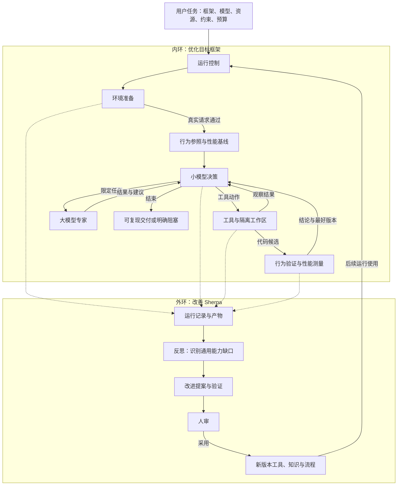

# 整体设计

## 目标与特点

Sherpa 是面向用户指定推理框架的优化系统。它在保持模型行为的前提下，寻找可复现的性能改进，并将专家经验沉淀为工具、知识和流程。

- **任务驱动**：用户指定框架、模型、资源、负载、行为约束和预算。
- **小模型主导**：小模型选择下一步；工具执行确定性工作；大模型处理限定任务，完成后交回控制权。
- **实验验证**：候选代码先通过行为检查，再与固定基线比较性能。
- **双环改进**：内环优化目标框架；外环根据运行记录改善 Sherpa 自身能力。
- **可追溯、可替换**：代码版本、决策、工具结果和成本关联保存；模型提供方通过适配器接入。

## 架构

下图描述目标架构。实现在[开发总览](../plan/overview.md)中跟踪。

环境准备也采用“观察—决策—执行—反馈”循环，完成条件是指定实现能处理约定的真实请求。优化内环在固定基线上反复实验；外环的变更经过验证和人审后用于后续运行。

## 模块划分

| 模块 | 职责 | 输出 |
|---|---|---|
| [运行控制](runtime.md) | 任务状态、隔离版本、预算、追踪和恢复 | Run、Call 与运行产物 |
| [Agent](agent.md) | 日常决策、限定专家任务、角色内容错、模型适配 | 下一步动作或限定任务结果 |
| [环境准备](environment.md) | 识别输入、调查依赖、构建环境、验证原始实现 | 可复现的运行条件 |
| 优化与评测 | 建立基线、执行候选实验、验证行为和收益 | 最好有效版本及测量证据 |
| 反思与知识 | 从 trace 提炼通用问题，验证并审核框架改进 | 新版本能力与适用范围 |

框架代码与模型产物是独立输入。内环可以修改目标代码的隔离候选；框架来源、模型行为契约和 Sherpa 自身规则由任务与版本管理约束。

## 机制为何有效

工具负责收集、执行和机械装配，降低模型处理细节的负担；小模型负责基于事实作选择，把开放式难题交给有边界的专家任务。

固定版本、行为契约和测量条件，使优化结论来自可比较实验。外环再将重复出现的困难转化为通用能力，减少后续任务的试错成本。

两类收益分别验证：目标优化看行为保真与性能；框架改进看整项任务的可靠性、总成本和完成时间。
